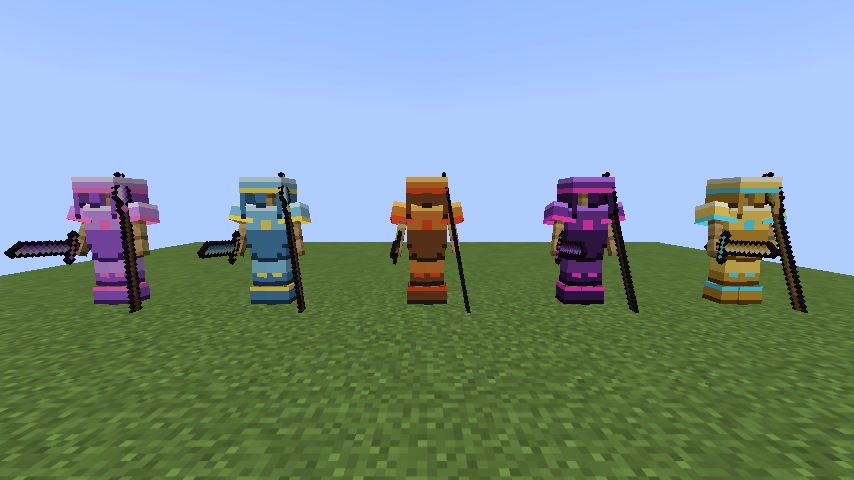
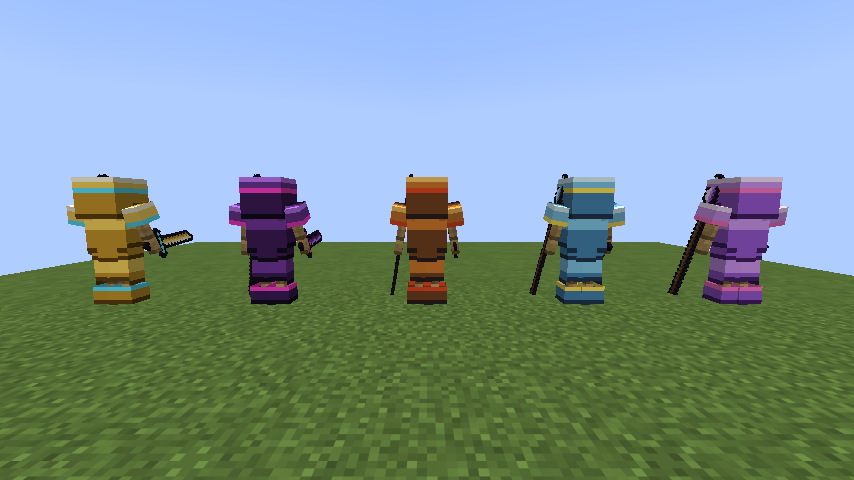

# Modernization World 1.0.0 변경 내역

Analog ALU 0.2.2와 Redstone Transportation 1.15.0을 합친 첫 버전입니다. (ALU 0.2.2는 소스가 GitHub와 이 컴퓨터에 없어서, 배포된 `analog-alu-0.2.2.jar`에서 코드와 리소스를 되살려 합쳤습니다. 아래 8장.)

## 1. 총기

| 총 | 장탄 | 피해 | 사거리 | 탄약 | 조작 |
|---|---|---|---|---|---|
| 리볼버 | 6발 | 25 | 32블록 | 9mm 총알 | 매번 R(공이치기) → 우클릭. 다 쓰면 R로 재장전 4초 |
| 머스킷 | 1발씩 | 30 | 48블록 | 머스킷 총알 | 우클릭. 쏠 때 바로 장전, 다음 발까지 3초 |
| 샷건 | 2발 | 산탄 40알 × 1.5 | 16블록 | 45게이지 산탄 | R로 재장전 3.5초, 우클릭 |

- 피해는 체력 기준이고 갑옷과 발사체 보호가 줄입니다.
- R 키는 조작 설정에서 바꿀 수 있습니다.
- 총 제작법은 요청에 없어 새로 정했습니다. 리볼버는 철 주괴·트립와이어 갈고리·판자, 머스킷은 철 주괴·부싯돌과 부시·원목, 샷건은 철 주괴·트립와이어 갈고리·부싯돌과 부시·원목입니다.
- 샷건 한 알의 피해 1.5도 요청에 없어 정한 값입니다.

- 손에 든 총은 **3D 모델**입니다(블록 여러 개로 만든 입체 모양). 1인칭에서는 총구가 앞을 향하고, 3인칭에서는 손에 쥐고 총구가 앞을 봅니다. 인벤토리와 액자에서는 알아보기 쉬운 평면 그림을 씁니다.

## 2. 흑색화약과 탄약

- 화약 + 석탄 또는 숯 → 흑색화약
- 뼛가루 + 석탄 또는 숯 + 부싯돌 → 화약 4개 (바닐라에는 화약 조합법이 없어서 새로 넣었습니다)
- 흑색화약 + 철 주괴 → 9mm 총알 4개
- 흑색화약 + 철 주괴 2 → 머스킷 총알 4개
- 흑색화약 + 철 조각 8 → 45게이지 산탄 1개

## 3. 석유

- 매장지가 생길 확률: 구역(13×13청크)마다 75% → **3.75%** (예전의 5%)
- 지표에 드러나는 비율(분출 통로, 마른 땅이면 석유 호수): 80% → **90%**
- 이미 생성된 청크의 석유는 그대로 남습니다.
- 시드 석유 지도 페이지도 새 확률에 맞췄고, 버전을 고를 수 있습니다.

## 4. 전기

- **직렬·병렬 연결**: 한 회로에 전원을 여러 개 이을 수 있습니다. 전에는 전원이 둘 이상이면 전기가 흐르지 않았습니다. 이제 회로 전체를 한 번에 풀어서, 직렬은 전압이 더해지고 병렬은 전류를 나눠 냅니다.
- 다 쓴 건전지, 연료 없는 발전기처럼 쓸 수 없는 전원은 회로에서 빠집니다.
- 고리가 닫히지 않아 전류가 없는 회로는 예전처럼 전기가 없습니다.
- 케이블 전압은 회로에서 가장 낮은 곳을 0V로 잽니다. 전원이 하나일 때는 예전과 같습니다.
- **+/− 표시**: 건전지·충전식 건전지·승압기·변압기는 빨간 원에 흰 +, 파란 원에 흰 −로 굵게 다시 그렸습니다. 석탄·디젤 발전기는 앞면에 + 표지를 달고 − 표지가 있는 뒷면을 새로 만들었습니다. 태양광·풍력 발전기는 받침 앞뒤에 표지를 달았습니다.

## 5. 자동화 기계 220V 200Ω

- 벌목기를 뺀 기계 5종(자동 식재기, 성장 촉진기, 작물 수확기, 채굴 드릴, 아이템 수거기)은 **220V에서 200Ω** 부하입니다. 한 대가 220V에서 1.1A, 242W를 씁니다.
- **공장 제어기가 연결된 기계 전체를 대표하는 부하**로 회로에 들어갑니다. 기계 n대면 200/n Ω(병렬)입니다. 제어기의 마주 보는 두 면(위·아래, 동·서, 남·북 순서로 처음 양쪽 다 케이블이 닿은 쌍)에 케이블을 잇습니다.
- 기계 속도 = 제어기 전압 ÷ 220V × 15(최대 15). 220V면 최고 속도, 110V면 세기 8입니다. 신호 제어 모드는 레드스톤 신호와 전기 중 작은 쪽을 씁니다.
- 제어기 없이 케이블에 바로 붙인 기계는 움직이지 않습니다. **벌목기**는 예전처럼 전기가 닿으면 움직이고 부하가 되지 않습니다.
- 제어기를 Shift+우클릭하면 전압, 전류, 전력, 기계 수가 나옵니다.
- 220V는 승압기로 만듭니다. 승압기를 우클릭하면 나오는 화면에 **220**을 입력하세요(ALU 0.2.2부터 1~3000V를 직접 입력).
- **220V 선은 PVC 피복 전선(600V까지 안전)으로 까세요.** 맨 구리 전선은 전기가 흐를 때 만지면 감전되는데(ALU 0.2.2), 220V에 기계 한 대만 걸려도 0.5초마다 피해 약 12입니다. − 쪽 전선은 0V라 안전합니다.
- 회로 계산에 ALU 블록이 아닌 부하(제어기)를 넣을 수 있게 했습니다(`ElectricLoad`).

## 6. 자동차

- 블록을 쌓아 차체를 만들고 **운전대**를 우클릭해 조립합니다. 엘리베이터·배·비행선과 같은 움직이는 구조물입니다.
- **필수 부품**: 운전대(핵심), 자동차 좌석 1개 이상, 맨 아래층 바퀴 4개 이상, 디젤 엔진 1개 이상, 연료통 1개 이상. 모자라면 조립하지 않고 무엇이 빠졌는지 알려 줍니다.
- **디젤**로 달립니다. 연료통에 디젤 16개, 디젤 1개로 2분. 연료통이나 조립된 차를 디젤로 우클릭해 넣습니다. 서 있을 때는 연료를 쓰지 않습니다.
- W/S 가속·후진, A/D 방향(굴러갈 때만 돕니다). 최고 약 43km/h. 한 칸 턱은 넘고, 받침이 없으면 떨어집니다.
- 되돌리면 연료통에 남은 디젤이 그대로 남습니다.
- 발전 과제 "드라이브"(자동차 조립)를 추가했습니다.
- 설명서: [docs/transportation/CAR_GUIDE_KO.md](docs/transportation/CAR_GUIDE_KO.md)

### 배와 비행선도 디젤로

- 배와 비행선에도 **연료통이 1개 이상** 있어야 조립되고, 연료통의 **디젤**로 움직입니다(디젤 1개로 2분).
- 움직이는 동안에만 연료를 씁니다. 다 떨어지면 배는 서서히 멈추고, 비행선은 그 높이에 떠 있습니다. 조종하면 "연료가 없습니다"가 나옵니다.
- 디젤을 들고 연료통이나 조립된 배·비행선을 우클릭해 넣습니다.
- 항로 표지는 연료가 있는 배·비행선만 부르고, 가는 길에 연료가 떨어지면 항로를 그만둡니다.
- 예전에 조립해 둔 배·비행선은 연료통이 없어 움직이지 않으니, 되돌려서 연료통을 붙이고 다시 조립하세요.
- 자동차도 연료가 없을 때 조종하면 "연료가 없습니다"가 나옵니다.

### 되돌린 뒤 옆 블록이 따라오던 문제 수정

- 배·비행선·자동차를 몰고 돌아와 집·나무·부두 같은 블록 옆에서 되돌리면, 다시 조립할 때 그 블록까지 같이 조립되던 문제를 고쳤습니다.
- 되돌릴 때 구조물 자신의 블록과 그때 닿아 있던 바깥 블록을 기억해 두고, 다시 조립할 때 바깥 블록과 옆에 정박한 다른 탈것의 블록은 남겨 둡니다. 기억은 월드에 저장됩니다.
- 정박해 있는 동안 직접 덧붙인 블록은 지금처럼 같이 조립됩니다.

## 7. 운동화

ALU 0.2.2의 운동화를 다음처럼 바꿨습니다. 제작법(나일론 섬유 2 + 합성 고무 2)은 그대로입니다.

| 항목 | 0.2.2 | 1.0.0 |
|---|---|---|
| 내구도 | 있음(닳음) | **없음, 무한** |
| 인챈트 | | **가능**(가벼운 착지, 보호, 물갈퀴, 영혼 가속 등 부츠 인챈트) |
| 이동 속도 | 그대로 | **+20%** |
| 허기 | 걷기·달리기에 없음 | **걷기·달리기·점프에 없음** (수영은 그대로) |
| 계단처럼 오르는 높이 | 1.0칸 | **1.8칸** |

## 8. ALU 0.2.2 포함

ALU 0.2.1 위에 합쳤던 것을, 0.2.2의 내용까지 들여왔습니다.

- **석유화학**: 석유 처리기는 플라스틱 원액 대신 **나프타**를 냅니다. 화학 반응기(전기 부하, 12V 이상)와 염소 생성기(4V 이상)로 에틸렌·프로필렌부터 PE·PP·PVC·페트·나일론·합성 고무·섬유까지 만듭니다. 예전 플라스틱 원액은 **원액 변환기**를 우클릭하면 나프타로 바뀝니다.
- **감전**: 전기가 흐르는 맨 구리 전선을 만지면 전압 × 전류 × 0.05의 피해(갑옷 무시). **PVC 피복 전선**(600V까지 안전), **PP 피복 전선**(1000V까지 안전). 절연 부츠는 감전을 막지만 닳습니다. 다 탄 전선은 불이 됩니다. 피복 전선도 운송 쪽 블록(동력 선로, 모터, 컨베이어, 벌목기)에 전기를 줍니다.
- **승압기·변압기 설정 화면**: 우클릭하면 화면이 열리고 목표 전압을 직접 입력합니다(승압기 1~3000V, 변압기 1~1000V). 0.2.1 월드의 설정은 같은 전압으로 읽힙니다.
- **전기충격기**: 생명체 우클릭으로 갑옷을 무시하는 피해 2와 2초 경직, 재사용 10초, 32회.
- **옷**: 정장, 장식 정장, 모직·면 바지, 치마(내구도 없음), 절연 부츠, 운동화.
- **아스팔트 블록**: 이동 +20%, 폭발에 강함, 염색 가능.
- 채굴기·석유 시추기·질량 분석기·석유 처리기의 결과물은 아래나 위의 호퍼로 바로 들어갑니다. 석유는 불이 붙고, 석유 속에서는 헤엄치기가 무겁습니다.
- 안내서에 석유화학·감전·의류·아스팔트·전기충격기 쪽이 늘었습니다.

## 9. 음반

| 음반 | 곡 | 길이 | 비교기 출력 | 제작법 |
|---|---|---|---|---|
| 음반 (Snowman) | Sia - Snowman | 2:46 | 13 | 아무 음반 + 눈 블록 |
| 음반 (Payphone) | Maroon 5 - Payphone (feat. Wiz Khalifa) | 3:53 | 14 | 아무 음반 + 종 |

- 주크박스에 넣으면 "지금 재생 중: Sia - Snowman"처럼 나오고, 바닐라 음반처럼 거리에 따라 소리가 줄어듭니다(모노).
- "아무 음반"은 바닐라 음반 22장 전부(Pigstep, otherside, Relic, Creator 등 포함)와 이 두 장, 그리고 공용 태그 `c:music_discs`에 든 다른 모드의 음반입니다.
- 스켈레톤이 죽인 크리퍼도 떨어뜨립니다. 크리에이티브에서는 도구 및 유틸리티 탭에 있습니다.
- 곡 파일은 상업 음원이라 **공개 GitHub 저장소에는 올리지 않도록** `.gitignore`에 넣었습니다. 직접 빌드한 jar에는 들어 있습니다.

## 10. 두 모드 합치기

- 모드 ID `modernization_world`, 이름 Modernization World, 버전 1.0.0.
- 블록·아이템 ID는 그대로(`analog_alu:…`, `redstone_transportation:…`)이고, `analog_alu`와 `redstone_transportation` 모드 ID를 대신 제공하므로 기존 월드를 이어서 쓸 수 있습니다.
- ALU가 늘 들어 있으므로 운송 쪽 동력 선로·모터·기계·컨베이어는 항상 전기로 움직입니다.
- 운송 쪽 문서는 `docs/transportation/`으로 옮겼습니다.
- ALU 저장소에 운송 쪽의 게임 테스트를 들여와 함께 돌립니다.

## 11. 보스 장비

보스를 잡으면 재료가 무작위 개수로 떨어지고(기존 전리품도 그대로), 그 재료로 검·곡괭이·도끼·삽·괭이·창과 투구·흉갑·레깅스·부츠를 만듭니다. 성능은 보스 순서(파편 드래곤 → 폭풍 와이번 → 성채 거수 → 공허의 지배자)대로 올라갑니다.

| 보스 | 재료 | 드롭 개수 |
|---|---|---|
| 파편 드래곤 | 수정 비늘 | 6~10 |
| 폭풍 와이번 | 폭풍 비늘 | 6~10 |
| 성채 거수 | 거수 장갑판 | 7~11 |
| 공허의 지배자 | 공허 주괴 | 8~12 |

| | 네더라이트 | 파편 | 폭풍 | 거수 | 공허 | 최종 |
|---|---|---|---|---|---|---|
| 검 피해 / 공격 속도 | 8 / 1.6 | 9 / 1.6 | 10 / 1.8 | 11 / 1.4 | 12 / 1.6 | 14 / 1.7 |
| 도끼 피해 | 10 | 11 | 12 | 13 | 14 | 16 |
| 창 피해 | 5 | 6 | 7 | 8 | 9 | 11 |
| 채굴 속도 | 9 | 10 | 11 | 11 | 13 | 15 |
| 내구도 | 2031 | 2600 | 3000 | 3800 | 4500 | 무한 |
| 인챈트 효율 | 15 | 16 | 18 | 15 | 20 | 22 |
| 방어 (투구/흉갑/레깅스/부츠) | 3/8/6/3 | 3/8/7/3 | 3/9/7/3 | 4/9/7/4 | 4/10/8/4 | 5/10/8/5 |
| 방어 강도 | 3 | 3.5 | 4 | 5 | 6 | 7 |
| 밀치기 저항 (부위당) | 0.1 | 0.1 | 0.05 | 0.2 | 0.15 | 0.25 |
| 갑옷 내구도 (네더라이트 대비) | 1 | 1.16배 | 1.3배 | 1.6배 | 1.9배 | 무한 |

- **4부위 세트 효과**: 파편은 화염 저항과 근접 공격자에게 피해 2 반사, 폭풍은 이동 속도 +10%와 낙하 피해 절반, 거수는 폭발 피해 −30%, 공허는 최대 체력 +4와 위더 면역, 최종은 네 가지 모두에 최대 체력 +8입니다. 한 부위라도 벗거나 다른 등급이 섞이면 0.5초 안에 효과가 사라집니다.
- **검 적중 효과**: 파편은 불 3초, 폭풍은 10% 확률로 번개, 거수는 강하게 밀쳐내기, 공허는 위더 2초, 최종은 전부입니다.
- **제작법**: 바닐라와 같은 모양에 철 대신 보스 재료, 손잡이는 막대기입니다. 창은 바닐라 창처럼 재료 1 + 막대기 2(대각선)입니다.
- **최종 장비**: 네 보스의 재료를 하나씩(수정 비늘·폭풍 비늘·거수 장갑판·공허 주괴) 제작대에 아무렇게나 놓으면 **최종 합금** 1개가 됩니다. 최종 장비는 다른 장비와 같은 모양에 최종 합금과 막대기로 만들고, 부서지지 않습니다.
- 수리는 모루에서 각 등급의 재료(최종은 최종 합금)로 합니다. 모든 보스 장비는 불에 타지 않습니다. 크리에이티브에서는 재료가 재료 탭, 장비가 전투 탭에 있습니다.
- 입었을 때의 갑옷은 얇게 그렸습니다. 투구는 얼굴 쪽이 열려 있고(코 보호대와 볼 보호대만), 흉갑은 가슴판과 어깨 보호대까지라 아래팔이 드러나며, 레깅스는 허리띠와 무릎까지의 허벅지 보호대, 부츠는 발목 높이입니다.
- 아이템 그림, 입었을 때의 갑옷, 손에 든 긴 창 모델은 `tools/boss_mode/gen_boss_gear.py`가 만듭니다.

## 12. 보스 체력

모든 보스가 페이즈마다 1,024였던 체력을, 1페이즈 100에서 시작해 페이즈가 오를수록 고르게 늘어나게 바꿨습니다.

| 보스 | 페이즈 | 페이즈별 체력 | 합계 |
|---|---|---|---|
| 파편 드래곤 | 10 | 100, 122, 144, 167, 189, 211, 233, 256, 278, 300 | 1,989 |
| 폭풍 와이번 | 5 | 100, 175, 250, 325, 400 | 1,250 |
| 성채 거수 | 8 | 100, 157, 214, 271, 329, 386, 443, 500 | 2,400 |
| 공허의 지배자 | 10 | 100, 156, 211, 267, 322, 378, 433, 489, 544, 600 | 3,500 |

- 페이즈가 넘어갈 때 새 페이즈의 체력으로 최대치가 바뀌고 꽉 채워집니다.
- 혼자 두면 차는 회복도 같은 비율로 줄였습니다. 예전에는 1,024 기준 초당 12/8/20/10이었고, 이제 그 페이즈 체력의 초당 1.2%/0.8%/2%/1%입니다(드래곤 1페이즈 초당 1.2, 10페이즈 3.6).
- 예전 버전에서 싸우던 보스가 저장된 월드를 열면, 남은 체력 비율 그대로 새 체력으로 바뀝니다.
- 체력과 관계된 다른 규칙(비행 중 페이즈 체력의 7%를 맞으면 추락, 마지막 페이즈 30~35%에서 분노)은 비율이라 그대로입니다.
- 지배자의 영혼 흡수(빼앗은 체력의 2배 회복)와 껍질의 한 대당 피해 상한 15, 파편 군주(체력 600)는 바꾸지 않았습니다.

## 검증

- **서버 게임 테스트**: 238개 모두 통과(아래 목록 외에 영국군 4개, 비행선 블록 회수 1개, 모터 2개, 보스 장비 11개, 보스 체력 4개).
  - 보스 체력 4개: 네 보스의 페이즈별 체력표, 처음 소환 때 100/100, 예전 버전(1,024)으로 저장된 마지막 페이즈 보스를 불러오면 새 체력의 절반으로 돌아옴, 체력이 바뀔 때 현재 체력은 최대치까지만 깎임.
  - 보스 장비 11개: 네 보스 각각 200번 잡아 재료 개수의 최소·최대가 표와 같음, 검·도끼·창 피해와 공격 속도·채굴 속도·내구도·인챈트 효율, 갑옷 방어·강도·밀치기 저항·내구도 비율, 바닐라 태그와 인챈트 가능 여부·각 등급 재료로 수리, 장비 50종 제작법(최종은 최종 합금으로), 네 보스 재료 하나씩으로 최종 합금 1개(같은 재료 두 개로는 안 되고, 보스 검 네 자루로는 이제 아무것도 안 나옴), 세트 효과 적용과 해제, 거수 세트가 폭발 10을 7로 받음, 파편 세트 반사, 검 효과 4종과 번개 확률 약 10%, 실제 휘두르기로 불붙이기.
  - 운송 172개: 합친 뒤에도 그대로 통과합니다(벌목기 말고는 220V 제어기를 거치도록 고쳤습니다).
  - 전원 7개: 제어기가 기계 한 대에 200Ω·두 대에 100Ω, 승압기 220V로 기계 두 대 가동, 그리고 9V 둘 직렬이 부하 양끝 17~18V, 병렬이 약 8.9V, 병렬 건전지가 혼자일 때의 절반씩만 닳음, 혼자인 건전지는 예전 값, 부하 없는 직렬은 0V.
  - 총기 12개: 리볼버는 공이치기 없이 안 나가고 R 후 25 피해, 29블록 명중·33블록 빗나감, 다이아 갑옷이 피해를 약 9로 줄임, 6발 재장전과 탄약 소모. 머스킷은 총알 없으면 안 나가고 39블록 30 피해, 3초 대기, 50블록 빗나감. 샷건은 4블록 45~60 피해, 두 발 뒤 빈 총, 18블록 빗나감, 산탄 2개 재장전. 레시피: 흑색화약은 석탄·숯 모두 되고 다이아로는 안 됨, 화약은 뼛가루+석탄/숯+부싯돌로 4개가 나오고 둘만으로는 안 됨, 탄약 3종, 총 3종.
  - 석유 3개: 4개 시드 4만 구역에서 매장지 비율과 호수 비율, 시드만으로 같은 결과, 시드 석유 지도와 같은 좌표.
  - 자동차 6개: 부품이 하나라도 없으면 조립 안 됨, 디젤로 달리며 연료 소모, 빈 연료통이면 그대로, 받침이 없으면 떨어짐, 한 칸 턱 넘기, 차에 디젤 넣기와 되돌린 뒤 연료 유지.
  - 배·비행선 연료 4개: 연료통이 없으면 배도 비행선도 조립 거부(빈 연료통이면 조립됨), 디젤 40틱어치를 다 쓰면 배가 멈춤, 연료 없는 비행선은 W+스페이스에도 그 자리에 떠 있다가 디젤 1개를 넣으면 출발, 항로 표지가 연료 없는 배는 부르지 않음. 기존 배·비행선 테스트는 연료통을 싣도록 고쳤습니다.
  - 정박 2개: 떠나 있는 동안 착륙 자리 옆에 세운 벽돌 벽은 다시 조립해도 남고 덧붙인 판자 한 장만 따라옴(저장했다 불러와도 기억 유지), 나란히 되돌린 두 비행선은 따로따로 조립됨.
  - 새 기능 8개: 운동화는 내구도 없음·부츠 인챈트 4종 가능·100 피해를 줘도 멀쩡, 속도 120%·오르기 1.8칸(벗으면 원래대로), 달리기 20칸·걷기 20칸·점프 10번에 허기 0(맨발은 허기 증가), 제작법 그대로. 음반 두 장이 주크박스에서 재생되고 길이·비교기 출력이 맞음, 크리퍼 드롭 음반이 아닌 것(Pigstep, otherside, Relic, Creator, 5, Precipice)과 새 음반으로도 제작, 다른 아이템으로는 안 됨. 피복 전선이 전기를 나르고 운송 블록에 신호를 주며 만져도 안전, 맨 구리 전선은 감전.
- **클라이언트 게임 테스트**: 실제 키 입력(R)과 우클릭으로 리볼버를 쏴서 허스크 체력이 줄어든 것을 확인했습니다. 3D 총을 든 1인칭·3인칭 모습, +/− 표시, 직렬 회로(17V 넘음), 운전대 클릭으로 자동차 조립과 W 키로 운전(좌석에 앉은 높이 확인), 주크박스에 음반을 넣어 재생(소리 이벤트와 음원 파일 확인)을 찍었고, 운송 쪽 화면 테스트도 모두 통과했습니다.
- **실제 서버**: 배포용 jar와 Fabric API만 넣은 전용 서버에서 직렬 회로 18V, 총·흑색화약 아이템, 운송 블록을 확인했습니다.
