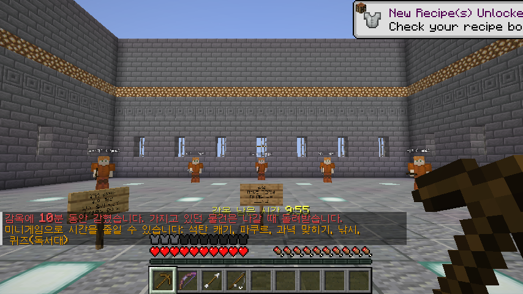
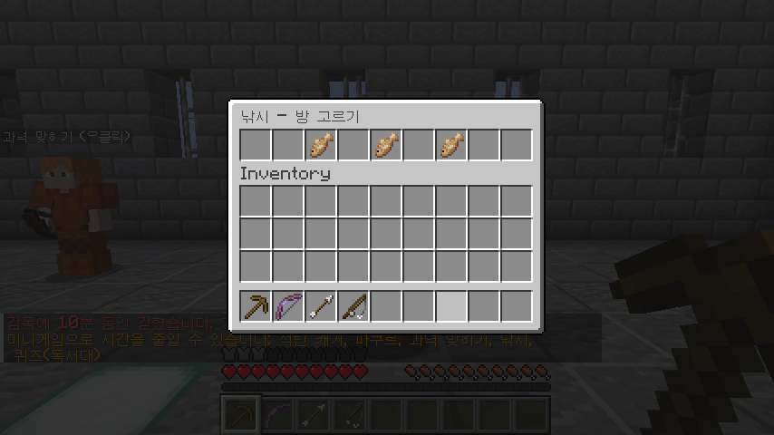
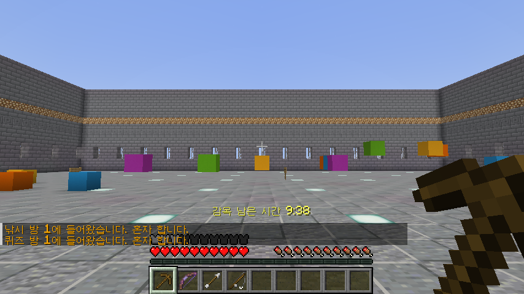
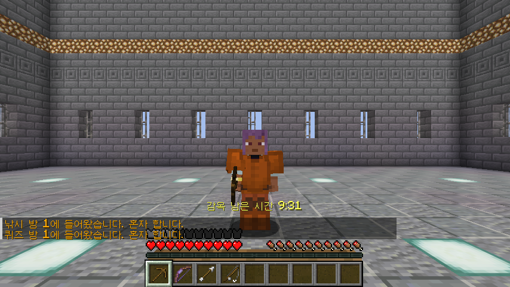

# 감옥 (Jail) - 서버 전용 모드

Minecraft 26.3 · Fabric (Fabric Loader 0.19.5 이상, Fabric API 필요)

**서버에만 넣으면 됩니다.** 새 블록·아이템을 추가하지 않고 바닐라 블록과 명령어만 쓰므로, 플레이어는 아무것도 설치하지 않고 접속할 수 있습니다.

## 명령어

| 명령어 | 권한 | 하는 일 |
|---|---|---|
| `/감옥 <닉네임> <분>` (`/jail`) | OP | 플레이어를 감옥에 보냅니다. 이미 감옥에 있으면 시간을 새로 정합니다. |
| `/석방 <닉네임>` (`/unjail`) | OP | 바로 풀어 줍니다. 접속해 있지 않으면 다음에 접속할 때 바로 풀려납니다. |
| `/감옥목록` (`/jaillist`) | OP | 감옥에 있는 사람과 남은 시간 |
| `/감옥시간` (`/jailtime`) | 누구나 | 내 남은 시간 |

## 감옥에 가면

- 새 차원 **`jail:jail`**의 감옥 마당(로비)으로 옮겨집니다. 사방이 벽이고 위는 보이지 않는 천장이라 나갈 수 없고, 밖으로 나가거나 다른 곳으로 순간이동하거나 죽어도 다시 마당으로 돌아옵니다.
- **가지고 있던 물건(갑옷·왼손 포함)은 모두 맡겨지고**, **주황색 죄수복**(상의·바지·신발, 귀속 저주라 벗을 수 없음)과 감옥 도구(나무 곡괭이, 무한 활과 화살, 낚싯대, 모두 부서지지 않음)를 받습니다.
- 감옥에서는 생존 모드이고, 석탄 광석 말고는 블록을 부수거나 놓을 수 없습니다. 배고픔은 자동으로 채워집니다.
- 남은 시간은 화면 아래에 계속 보이고, **접속해 있는 동안에만** 줄어듭니다.

## 미니게임 방

- 마당에는 미니게임마다 **NPC**(죄수복을 입은 다른 죄수, 그 미니게임 도구를 들고 있음)가 하나씩 서 있습니다. **우클릭**하면 그 미니게임의 **방 3개**와 각 방에 있는 사람이 나오고, 방을 누르면 그 방으로 갑니다.
- 친구가 있는 방을 고르면 **같이**, 빈 방을 고르면 **혼자** 합니다. 방은 감옥 차원 안에서 서로 멀리 떨어져 있어 다른 방과는 만날 수 없습니다.
- **같이 하면**: 누가 시간을 줄이면 **직접 한 사람은 그대로**, 같은 방의 **다른 사람은 그 1/10**만큼 같이 줄어듭니다. 다른 방 사람은 줄지 않습니다.
- 방마다 **"마당으로 돌아가기" NPC**가 있습니다.

| 미니게임 | 하는 법 | 줄어드는 시간 | 쿨타임 |
|---|---|---|---|
| 석탄 캐기 | 양쪽 긴 벽의 석탄 광석을 곡괭이로 캐기 | 1개당 10초 | 3초 (그동안은 캘 수 없음). 캔 자리는 45초 뒤 다시 생김 |
| 파쿠르 | 에메랄드 블록에서 시작해 색깔 블록을 밟고 금 블록까지 | 30초 | 3분 (그동안 완주하면 시작점으로만 돌아감) |
| 과녁 맞히기 | 빨간 선 뒤에서 활로 과녁 맞히기 | 15초, 정중앙 30초 | 5초 |
| 낚시 | 큰 연못에서 물고기 낚기 (물고기는 바로 가져감) | 1마리당 20초 | 20초 (그동안 낚은 물고기는 인정 안 됨) |
| 퀴즈 | 독서대를 우클릭하면 계산 문제, 채팅창에 숫자로 답하기 | 정답 30초 | 답한 뒤 30초 동안 새 문제 없음 |

쿨타임 중이면 화면 아래에 남은 쿨타임이 나옵니다. 숫자는 `MiniGames.java` 맨 위에 모여 있습니다.

**파쿠르 코스**는 4칸 점프(블록 사이 3칸), 대각선 점프, 올라가는 점프, 내려가는 5칸 점프, 그리고 45 스트레이프가 필요한 5칸 점프(착지 블록 3칸 폭)로 되어 있습니다. 떨어지면 바닥에 내려와서 시작점부터 다시 합니다.

## 나올 때

- 감옥에서 얻은 것(석탄, 낚은 것, 죄수복, 감옥 도구)은 **전부 사라지고**, 맡긴 물건이 원래 칸 그대로 돌아옵니다.
- **레벨과 경험치는 감옥에 가기 전 그대로** 돌아옵니다(석탄으로 얻은 경험치는 남지 않습니다).
- 감옥에 간 자리와 게임 모드로 돌아갑니다.

## 설치

1. 서버의 `mods` 폴더에 `jail-1.0.0.jar`와 Fabric API를 넣습니다.
2. 서버를 켜면 감옥 차원이 생기고 마당이 자동으로 지어집니다(로그에 `Jail ready in ... jail:jail`). 미니게임 방은 처음 누가 들어갈 때 지어집니다.
3. 이전 버전에서 쓰던 감옥은 자동으로 새 마당으로 다시 지어집니다.

## 검증

- 서버 게임 테스트 9개 통과:
  - 물건·레벨·자리·게임 모드를 맡겼다 돌려줌(석탄·죄수복·감옥 도구는 사라짐), 죄수복 색
  - 다섯 미니게임이 각자의 방에서 시간을 줄이고, 쿨타임 동안은 인정되지 않음(파쿠르 30초)
  - 같은 방의 친구는 1/10, 다른 방은 0
  - 마당 NPC 5명(죄수복), 실제 게임처럼 클릭 위치가 붙은 우클릭으로 방 고르기 창, 방을 누르면 그 방으로, 방의 NPC로 마당 복귀
  - 퀴즈가 한 번 우클릭에 한 번만 나옴(보조손 패킷 무시)
  - 시간이 다 되면 자동 석방, 저장했다 불러와도 그대로, `/감옥`·`/석방` 한글 명령어
- 실제 전용 서버에서 감옥 차원이 생기는 것을 확인했습니다.
- 싱글플레이 화면에서 `/감옥` → 마당 NPC를 **실제 우클릭 키로** 눌러 방 고르기 창, 방의 NPC를 실제 우클릭해 마당 복귀, 다섯 방, 파쿠르 코스, 죄수복 → `/석방`까지 확인했습니다.
- 파쿠르 점프를 사람이 직접 끝까지 뛰어 보지는 않았습니다.
